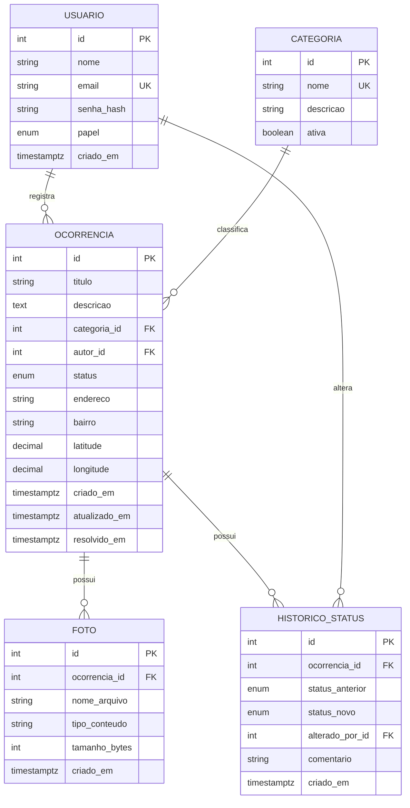
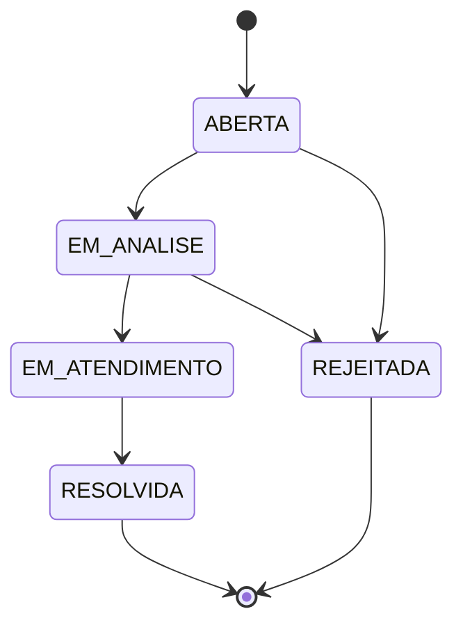

# 3. Modelo de dados

Banco: PostgreSQL 16. O esquema é criado pelas migrações do Alembic (`alembic/versions/`).

## Diagrama

## Relacionamentos

| Relacionamento | Cardinalidade | Ao excluir |
|---|---|---|
| usuario → ocorrencia (autor) | 1 para N | Restrito |
| categoria → ocorrencia | 1 para N | Restrito: categoria em uso não é excluída, é desativada |
| ocorrencia → foto | 1 para N (máximo 5) | Em cascata; o arquivo também é removido do disco |
| ocorrencia → historico_status | 1 para N | Em cascata |
| usuario → historico_status (responsável) | 1 para N | Restrito |

## Entidades

### usuario

| Campo | Tipo | Regras |
|---|---|---|
| id | inteiro | chave primária |
| nome | texto (120) | obrigatório |
| email | texto (255) | obrigatório, único |
| senha_hash | texto | obrigatório (bcrypt) |
| papel | enum `papel` | `CIDADAO` ou `GESTOR`; padrão `CIDADAO` |
| criado_em | data e hora | automático |

### categoria

| Campo | Tipo | Regras |
|---|---|---|
| id | inteiro | chave primária |
| nome | texto (80) | obrigatório, único |
| descricao | texto (255) | opcional |
| ativa | booleano | padrão verdadeiro |

### ocorrencia

| Campo | Tipo | Regras |
|---|---|---|
| id | inteiro | chave primária |
| titulo | texto (120) | obrigatório, mínimo 5 caracteres |
| descricao | texto | obrigatório, mínimo 10 caracteres |
| categoria_id | FK categoria | obrigatório; a categoria deve estar ativa |
| autor_id | FK usuario | preenchido com o usuário logado |
| status | enum `status_ocorrencia` | padrão `ABERTA` |
| endereco | texto (255) | obrigatório |
| bairro | texto (80) | obrigatório, indexado |
| latitude | decimal (9,6) | opcional, entre -90 e 90 |
| longitude | decimal (9,6) | opcional, entre -180 e 180 |
| criado_em | data e hora | automático |
| atualizado_em | data e hora | automático a cada alteração |
| resolvido_em | data e hora | preenchido ao entrar em `RESOLVIDA` |

Latitude e longitude são informadas juntas ou nenhuma das duas.

### foto

| Campo | Tipo | Regras |
|---|---|---|
| id | inteiro | chave primária |
| ocorrencia_id | FK ocorrencia | exclusão em cascata, indexado |
| nome_arquivo | texto | nome gerado (UUID + extensão) |
| tipo_conteudo | texto | `image/jpeg`, `image/png` ou `image/webp` |
| tamanho_bytes | inteiro | máximo 5 MB |
| criado_em | data e hora | automático |

### historico_status

| Campo | Tipo | Regras |
|---|---|---|
| id | inteiro | chave primária |
| ocorrencia_id | FK ocorrencia | exclusão em cascata, indexado |
| status_anterior | enum `status_ocorrencia` | nulo no registro de criação |
| status_novo | enum `status_ocorrencia` | obrigatório |
| alterado_por_id | FK usuario | obrigatório |
| comentario | texto (500) | opcional; obrigatório ao rejeitar |
| criado_em | data e hora | automático |

## Status da ocorrência

`RESOLVIDA` e `REJEITADA` são estados finais. Qualquer transição fora do diagrama é recusada com 409.

## Observações

- As regras de tamanho mínimo, faixa de coordenadas, limite de fotos e transições de status são aplicadas pela aplicação (schemas e serviços), não por restrições do banco.
- Datas são gravadas com fuso horário (UTC).
- Os arquivos das fotos não ficam no banco: a tabela `foto` guarda apenas o nome do arquivo, que fica na pasta definida em `UPLOAD_DIR`.
