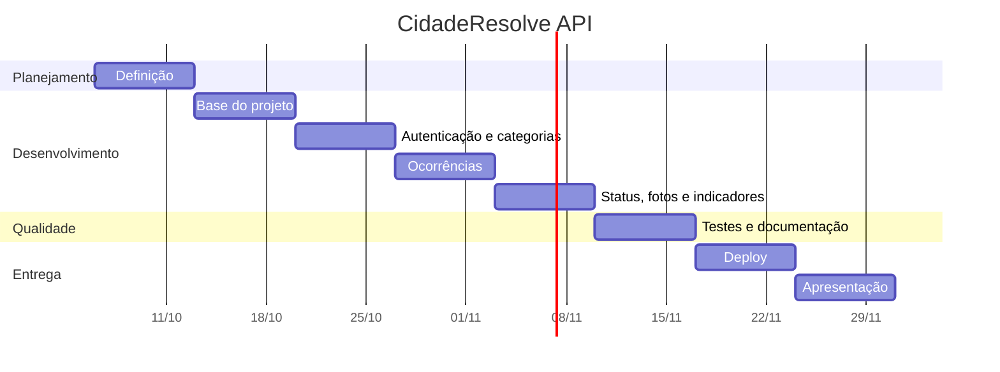

# 4. Planejamento e cronograma

> Cronograma em etapas de uma semana, tomando como referência 13/10/2026, dia em que a especificação de design foi fechada. Ajuste as datas e os responsáveis ao calendário da disciplina e à composição do grupo.

## Etapas

| Etapa | Período | Entregas |
|---|---|---|
| 1. Definição | 06/10 a 12/10/2026 | Problema, público-alvo, escopo e especificação de design |
| 2. Base do projeto | 13/10 a 19/10/2026 | Estrutura em camadas, configuração, modelos, migração inicial, Docker e docker-compose |
| 3. Autenticação e categorias | 20/10 a 26/10/2026 | Cadastro, login com JWT, papéis, CRUD de categorias, carga inicial |
| 4. Ocorrências | 27/10 a 02/11/2026 | CRUD de ocorrências, filtros, paginação, regras de dono |
| 5. Status, fotos e indicadores | 03/11 a 09/11/2026 | Fluxo de status com histórico, upload de fotos, indicadores |
| 6. Testes e documentação | 10/11 a 16/11/2026 | Testes automatizados, coleção Postman, documentos do projeto, README |
| 7. Deploy | 17/11 a 23/11/2026 | Publicação no Render, validação do fluxo no ambiente público |
| 8. Apresentação | 24/11 a 30/11/2026 | Roteiro de demonstração, ensaio e entrega final |

## Detalhamento das atividades

| Etapa | Atividades |
|---|---|
| 1 | Levantar o problema e a dor do público-alvo; definir escopo e o que fica de fora; escolher a stack; escrever a especificação. |
| 2 | Criar a estrutura de pastas; configurar variáveis de ambiente; modelar as cinco entidades; escrever a migração inicial; preparar Dockerfile e docker-compose. |
| 3 | Implementar hash de senha e JWT; rotas de registro, login e usuário logado; CRUD de categorias com bloqueio para não gestores; carga inicial idempotente. |
| 4 | Implementar criação, consulta, alteração e exclusão de ocorrências; validações; filtros por bairro, categoria e status; paginação. |
| 5 | Implementar as transições de status e o histórico; upload com validação de tipo, tamanho e limite; cálculo dos indicadores. |
| 6 | Escrever os testes com pytest; montar a coleção Postman com o fluxo de demonstração; redigir problema, requisitos, modelo de dados e README. |
| 7 | Criar o serviço web e o banco no Render; configurar as variáveis; rodar o fluxo de demonstração na URL pública. |
| 8 | Preparar a apresentação e ensaiar a demonstração pelo Swagger e pelo Postman. |

## Riscos

| Risco | Impacto | Como tratar |
|---|---|---|
| Disco do plano gratuito do Render é apagado a cada deploy ou reinício | Fotos enviadas no ambiente público se perdem | Limitação documentada; demonstrar o upload logo antes da apresentação ou no ambiente local |
| Serviço gratuito "dorme" após inatividade | Primeira requisição demora | Acessar `/saude` alguns minutos antes da demonstração |
| Banco gratuito do Render tem prazo de validade | Ambiente público pode sair do ar | Criar o banco perto da data da apresentação |
