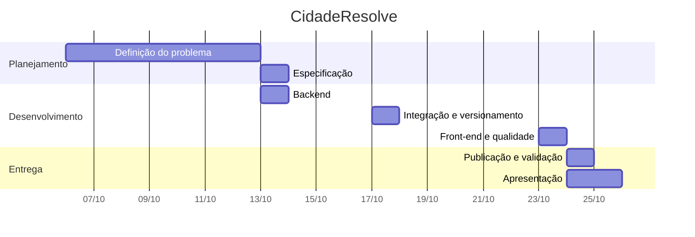

# 4. Planejamento e cronograma

Projeto individual de **Guilherme Cardozo Almeida Santos**. Entrega em **25/10/2026**.

## Metodologia

Desenvolvimento **incremental e iterativo**, inspirado em práticas ágeis: o trabalho foi dividido em entregas curtas, cada uma terminando com algo funcionando e testado (backend, depois Postman e repositório, depois site e testes de carga). A cada etapa, os testes automatizados conferem que nada do que já funcionava quebrou.

## Etapas

| Etapa | Período | Entregas |
|---|---|---|
| 1. Definição | 06/10 a 12/10/2026 | Problema, público-alvo, causas e efeitos, escopo |
| 2. Especificação | 13/10/2026 | Requisitos, modelo de dados, regras de negócio, endpoints e tecnologias |
| 3. Backend | 13/10/2026 | API em camadas, banco com migrações, autenticação, CRUDs, status com histórico, fotos, indicadores, testes automatizados, Docker |
| 4. Integração e versionamento | 17/10/2026 | Repositório no GitHub, coleção do Postman integrada ao Postman Desktop |
| 5. Front-end e qualidade | 23/10/2026 | Site (lista com mapa, registro com foto, acompanhamento, painel do gestor), teste de carga, correção de concorrência, documentação de testes, impacto e boas práticas |
| 6. Publicação e validação | 24/10/2026 | Deploy no Render, teste no ambiente publicado, teste de usabilidade com usuários, coleta de feedback |
| 7. Apresentação | 24/10 a 25/10/2026 | Slides, vídeo, ensaio da demonstração e entrega |

## Detalhamento das atividades

| Etapa | Atividades |
|---|---|
| 1 | Levantar o problema e a dor do público-alvo; mapear causas e efeitos; definir o que fica de fora. |
| 2 | Escrever requisitos funcionais e não funcionais; modelar as cinco entidades; definir o fluxo de status, as permissões e os endpoints; escolher a stack. |
| 3 | Implementar as camadas (rotas, serviços, repositórios); migração inicial; JWT e bcrypt; CRUD de categorias e ocorrências; transições de status com histórico; upload com validação; indicadores; testes com pytest; Dockerfile e docker-compose. |
| 4 | Publicar o código no GitHub; montar a coleção Postman com o fluxo de demonstração; integrar ao Postman Desktop. |
| 5 | Construir o site servido pela própria API; testar todas as telas no navegador; rodar teste de carga com 50 e 200 usuários; corrigir a condição de corrida encontrada; documentar testes, impacto, melhorias e boas práticas. |
| 6 | Publicar no Render; rodar o fluxo do Postman na URL pública; aplicar o roteiro de usabilidade e o questionário SUS com 3 a 5 pessoas; registrar o feedback. |
| 7 | Montar os slides e gravar o vídeo seguindo [09-apresentacao.md](09-apresentacao.md); ensaiar a demonstração; entregar. |

## Organização do trabalho

Por ser um projeto individual, as tarefas foram organizadas como uma lista priorizada, seguindo a ordem das etapas acima, e o progresso ficou registrado nos commits do repositório. Para trabalho em grupo, a divisão natural seria por camada, aproveitando a separação da arquitetura: uma pessoa no backend e no banco, uma no front-end, uma nos testes e na documentação, e todas na apresentação.

## Riscos

| Risco | Impacto | Como tratar |
|---|---|---|
| Prazo curto até a entrega | Itens finais ficarem incompletos | Prioridade para o que o enunciado exige; melhorias extras ficam na lista de melhorias |
| Disco do plano gratuito do Render é apagado a cada deploy ou reinício | Fotos enviadas no ambiente público se perdem | Limitação documentada; demonstrar o envio de foto ao vivo |
| Serviço gratuito "dorme" após inatividade | Primeira requisição demora | Acessar `/saude` alguns minutos antes da apresentação |
| Banco gratuito do Render tem prazo de validade | Ambiente público pode sair do ar depois da entrega | Recriar pelo `render.yaml` se necessário |
