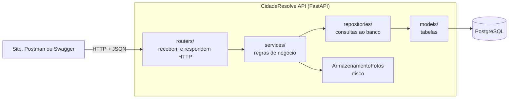

# 8. Boas práticas de desenvolvimento

Este documento mostra onde o código aplica Clean Code, os princípios SOLID, segurança e versionamento, com referência aos arquivos.

## 1. Arquitetura em camadas

Cada camada só conhece a de baixo:

| Camada | Pasta | Faz | Não faz |
|---|---|---|---|
| Rotas | `app/routers/` | Lê a requisição, chama o serviço, devolve a resposta | Não tem regra de negócio |
| Serviços | `app/services/` | Permissões, fluxo de status, limites de fotos, indicadores | Não conhece HTTP nem códigos de status |
| Repositórios | `app/repositories/` | Consultas SQL com SQLAlchemy | Não decide nada |
| Modelos e schemas | `app/models/`, `app/schemas/` | Tabelas e contratos de entrada e saída | Não acessam o banco |

Resultado prático: a mesma regra de negócio é usada pela API, pela carga de demonstração (`app/demo.py`) e pelos testes, sem duplicar código.

## 2. Princípios SOLID

| Princípio | O que diz | Onde aparece |
|---|---|---|
| **S**: responsabilidade única | Cada classe tem um motivo para mudar | `OcorrenciaServico` cuida do ciclo da ocorrência; `FotoServico`, das fotos; `IndicadoresServico`, dos números. Cada repositório cuida de uma tabela |
| **O**: aberto/fechado | Estender sem modificar | Uma nova forma de guardar fotos (por exemplo, na nuvem) é uma nova classe que implementa `ArmazenamentoFotos`, sem tocar nos serviços. Novas exceções de negócio entram no mapa `STATUS_POR_ERRO` de `app/main.py` |
| **L**: substituição de Liskov | Subtipos funcionam no lugar do tipo base | `ArmazenamentoFotosDisco` pode ser trocado por qualquer outra implementação de `ArmazenamentoFotos`; os testes usam uma pasta temporária sem mudar nada no serviço |
| **I**: segregação de interfaces | Interfaces pequenas e específicas | `ArmazenamentoFotos` tem só dois métodos (`salvar` e `excluir`); cada repositório expõe só as consultas da sua tabela |
| **D**: inversão de dependência | Depender de abstrações, não de detalhes | Os serviços recebem a sessão do banco e o armazenamento pelo construtor; quem monta as dependências é `app/core/dependencias.py`, pelo sistema de injeção do FastAPI |

## 3. Clean Code

- **Nomes que dizem o que fazem**, em português, alinhados ao vocabulário do problema: `mudar_status`, `exigir_pode_modificar`, `contar_por_categoria`, `TRANSICOES`.
- **Funções curtas e de um nível de abstração.** Exemplo: `OcorrenciaServico.mudar_status` lê como a regra escrita na especificação (verifica permissão, valida a transição, exige comentário, grava o histórico).
- **Regras em um só lugar.** O fluxo de status é um dicionário (`TRANSICOES` em `app/services/ocorrencia.py`); limites como 5 fotos e 5 MB são constantes nomeadas em `app/services/foto.py`.
- **Erros explícitos.** Exceções de negócio com código e mensagem (`app/core/excecoes.py`), convertidas num formato único de resposta.
- **Sem duplicação.** Permissões em `app/services/permissoes.py`, usadas por ocorrências e fotos.
- **Configuração fora do código**: tudo por variáveis de ambiente (`app/core/config.py`).

## 4. Segurança

| Risco | Proteção | Onde |
|---|---|---|
| Vazamento de senhas | Guardadas só como hash bcrypt, nunca em texto | `app/core/seguranca.py` |
| Acesso indevido | Token JWT com validade; permissões verificadas no servidor, não só na tela | `app/core/dependencias.py`, `app/services/permissoes.py` |
| Exposição de dados pessoais | Respostas públicas mostram só o nome do autor, nunca o e-mail | `app/schemas/ocorrencia.py` (`AutorSaida`) |
| Arquivo malicioso disfarçado de imagem | Tipo verificado pelo conteúdo do arquivo, não pela extensão; nome gerado pelo servidor | `app/services/foto.py` |
| Injeção de SQL | Consultas pelo ORM, com parâmetros | `app/repositories/` |
| Injeção de HTML (XSS) no site | Todo texto vindo da API é escapado antes de aparecer na tela | `frontend/js/html.js` |
| Mudanças simultâneas corrompendo o histórico | Trava da linha no banco durante a mudança de status | `OcorrenciaRepositorio.travar` |
| Segredos no repositório | `.env` fora do Git; apenas `.env.example` com valores de exemplo | `.gitignore` |

## 5. Versionamento com Git

- Repositório: https://github.com/Jovemzs/CidadeResolveAPI
- Commits pequenos e com mensagem descritiva no padrão *Conventional Commits* (`feat:`, `fix:`, `docs:`), contando a evolução do projeto.
- O banco evolui por **migrações** (`alembic/versions/`), também versionadas: qualquer pessoa recria o mesmo esquema com `alembic upgrade head`.
- A coleção do Postman fica no repositório, integrada ao Postman Desktop pela pasta `.postman/`.

## 6. Ambientes

| Ambiente | Como sobe | Banco |
|---|---|---|
| Desenvolvimento | `docker compose up` | PostgreSQL em contêiner, com volume |
| Testes | `pytest` | Banco separado, recriado a cada execução |
| Produção | Render, a partir do `render.yaml` e da mesma imagem Docker | PostgreSQL gerenciado |
